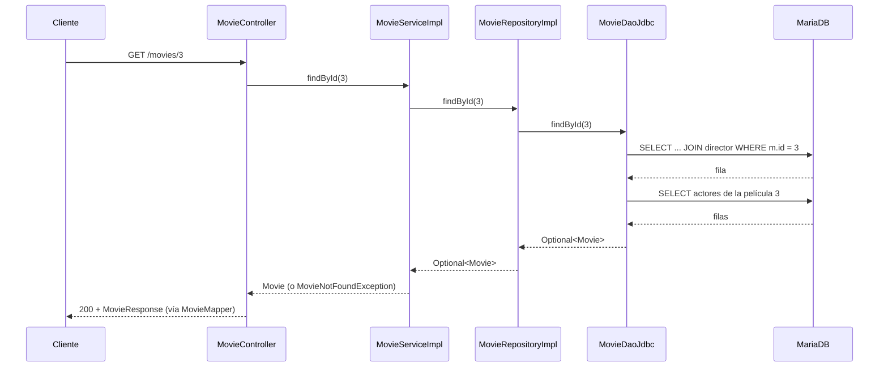

# Entender el código: recorrido de una petición

> **Para quién:** para ti, que quieres saber qué hace cada clase y por qué está donde está.
> **Qué cubre:** el código tal como está tras el giro del 2026-11-04 (tipos simples, JDBC, sin *value objects*, sin JPA). La referencia técnica es [`docs/arquitectura.md`](../../arquitectura.md) y la decisión, **D-48**.
> **Cómo leerlo:** de arriba abajo. Cada sección termina con una idea para recordar. Al final hay preguntas con su respuesta.

---

## 1. La idea general: un restaurante

Una aplicación web recibe pedidos (peticiones HTTP) y devuelve platos (respuestas JSON). Se parece a un restaurante:

```
   CLIENTE                    RESTAURANTE
  (Swagger,       ┌─────────────────────────────────────────┐
   navegador,     │  CAMARERO      JEFE DE SALA    ALMACENISTA│
   Postman)       │ (controller)   (domain/service) (persistence)│
      │           │      │               │              │     │
      │  pedido   │      ▼               ▼              ▼     │
      └──────────▶│  recibe y      decide qué      va a la    │
                  │  comprueba     hay que hacer   despensa   │
      ◀───────────│  el pedido     (las reglas)    (MariaDB)  │
        plato     │                                           │
                  │          RECETARIO (domain/model)         │
                  │       qué es una película, un actor...    │
                  └─────────────────────────────────────────┘
```


| En el restaurante   | En el código | Paquete          | Qué hace                                                          |
| ------------------- | ------------ | ---------------- | ----------------------------------------------------------------- |
| El **camarero**     | Controlador  | `controller`     | Recibe la petición HTTP, la comprueba y devuelve la respuesta     |
| El **jefe de sala** | Servicio     | `domain.service` | Decide qué hay que hacer: «¿existe esa película? ¿y su director?» |
| El **recetario**    | Modelo       | `domain.model`   | Define qué es una `Movie`, un `Director`, un `Actor`              |
| El **almacenista**  | Persistencia | `persistence`    | Sabe ir a la despensa (la base de datos) a por los datos          |


> **Regla de oro:** el jefe de sala y el recetario **no saben** cómo es la puerta del restaurante ni cómo es la despensa. Dentro de `domain` no verás nunca un `import` de `controller` ni de `persistence`.

**Para recordar:** cada capa tiene un trabajo y solo uno.

---

## 2. El mapa de paquetes

```
com.daw.movies
│
├── MoviesApplication            ← arranca Spring Boot
│
├── controller                   ← LA PUERTA (HTTP)
│   ├── MovieController          ← los 5 endpoints de /movies
│   ├── dto
│   │   ├── request  MovieRequest     ← JSON que ENTRA (+ validaciones)
│   │   └── response MovieResponse    ← JSON que SALE
│   ├── mapper    MovieMapper         ← convierte Movie → MovieResponse
│   └── handler   GlobalExceptionHandler  ← convierte errores en 404 / 400
│
├── domain                       ← EL NEGOCIO (el corazón)
│   ├── model      Movie, Director, Actor
│   ├── service    MovieService (interfaz)
│   │   └── impl   MovieServiceImpl     ← los casos de uso
│   ├── repository MovieRepository (interfaz) ← "lo que el dominio necesita"
│   └── exception  MovieNotFoundException, DirectorNotFoundException
│
└── persistence                  ← LA DESPENSA (base de datos)
    ├── repository.impl  MovieRepositoryImpl   ← cumple MovieRepository
    └── dao
        ├── MovieDao (interfaz)
        └── impl.jdbc  MovieDaoJdbc            ← el SQL de verdad
```

**Para recordar:** tres carpetas grandes: `controller` (hacia fuera), `domain` (el negocio) y `persistence` (hacia la base).

---

## 3. El recorrido de una petición: `GET /movies/3`

### El viaje, contado en lenguaje natural

Estás en la web y haces click en la tarjeta de *Inception*. El navegador lanza una petición HTTP: `GET /movies/3` (el `3` es el id de la película). Esa petición llega a la única puerta de la aplicación, `MovieController`: Spring, leyendo su `@GetMapping("/{id}")`, sabe que es para él, y la anotación `@PathVariable` convierte ese `3` de la URL en un `Long id`. El controlador no piensa nada: solo pasa el encargo y dice *`movieService.findById(3)`*.

El encargo aterriza en `MovieServiceImpl`, el jefe de sala, que aplica la regla del negocio: «para servir una película, primero debe existir». Le pasa el recado a su proveedor — la interfaz `MovieRepository` del propio `domain` — con *`movieRepository.findById(3)`*. La interfaz no sabe hacer nada por sí sola, así que lo ejecuta quien la cumple en la parte de abajo, `MovieRepositoryImpl` (paquete `persistence`). Hoy solo hace de pasamanos: reenvía la pregunta al DAO con *`movieDao.findById(3)`*.

El DAO, `MovieDaoJdbc`, es el único que sabe hablar con la base de datos: lanza a MariaDB un `SELECT ... JOIN` que junto la fila de la película y su director, y una segunda consulta para traer los actores. MariaDB devuelve filas crudas, y el `RowMapper` (`mapMovie()`) las transforma, una a una, de regreso a objetos Java: un `Movie` con su `Director` y sus `Actor`es.

Ahora el dato sube por el mismo camino al revés: del DAO al `MovieRepositoryImpl`, que se lo entrega al servicio empaquetado en un `Optional<Movie>`. El servicio abre la caja: **si está vacía, lanza `MovieNotFoundException`** y saltamos al grupo de abajo; si trae la película, se la devuelve al controlador en crudo (el `Movie` del modelo), pero el JSON que verás en pantalla todavía no existe. El controlador pasa ese `Movie` por `MovieMapper`, que lo traduce a un `MovieResponse`: solo título, año, duración, y director y actores con su `id` y `fullName` — la cocina no se enseña entera, solo el plato.

Y por fin llega a tu navegador un `200 OK` con el JSON, que es lo que la web pinta en la tarjeta que clicaste.

**Y si algo falla por el camino:** si la `Optional` venía vacía, la excepción sube hasta `GlobalExceptionHandler`, que la traduce a un `404` con un mensaje («no existe la película 3») — tu web puede avisar con elegancia de que esa película ya no está. Lo mismo pasa con un id raro como `/movies/abc` (Spring no lo convierte a número → `400`) o con cualquier validación de un `POST` que no pase (→ `400`).

> **Para recordar:** la petición baja **Controller → Service → Repository → DAO → base**, y el dato sube por las mismas capas en orden inverso, transformándose dos veces en el viaje: filas → `Movie` (el `RowMapper`) y `Movie` → JSON (el `MovieMapper`).

### 3.1 El dibujo

```
 Cliente
   │  GET /movies/3
   ▼
┌──────────────────┐
│ MovieController  │  1. Spring convierte "3" en Long id
│   findById(3)    │
└────────┬─────────┘
         │ movieService.findById(3)
         ▼
┌──────────────────┐
│ MovieServiceImpl │  2. pide la película; si no existe → lanza
│   findById(3)    │     MovieNotFoundException
└────────┬─────────┘
         │ movieRepository.findById(3)
         ▼
┌──────────────────┐
│MovieRepositoryImpl│ 3. pasa la pregunta al DAO
└────────┬─────────┘
         │ movieDao.findById(3)
         ▼
┌──────────────────┐
│  MovieDaoJdbc    │  4. SQL: JOIN movie + director
│                  │     + 2ª consulta con los actores
└────────┬─────────┘
         │ SELECT ...
         ▼
     [ MariaDB ]
         │ filas
         ▼
   RowMapper: fila → objeto Movie  (viaja de vuelta hacia arriba)
         │
         ▼
┌──────────────────┐
│   MovieMapper    │  5. Movie → MovieResponse (el JSON)
└────────┬─────────┘
         ▼
      Cliente  ◀── 200 OK  { "id": 3, "title": "...", "director": {...}, "actors": [...] }
```

### 3.2 La misma historia como diagrama de secuencia



### 3.3 Paso a paso, con el código

**① Controlador** — `MovieController.findById`

```java
@GetMapping("/{id}")
public MovieResponse findById(@PathVariable Long id) {
    return movieMapper.toResponse(movieService.findById(id));
}
```

No tiene lógica: llama al servicio y convierte el resultado. `@PathVariable` toma el `3` de la URL.

**② Servicio** — `MovieServiceImpl.findById`

```java
return movieRepository.findById(id)
        .orElseThrow(() -> new MovieNotFoundException(id));
```

`findById` del repositorio devuelve un `Optional`: una «caja» que puede tener la película o estar vacía. Si está vacía, el servicio lanza la excepción. Así nunca circula un `null`.

**③ Repositorio** — `MovieRepositoryImpl.findById`

```java
return movieDao.findById(id);
```

Hoy solo pasa la llamada. Por qué existe se explica en la sección 5.

**④ DAO** — `MovieDaoJdbc.findById`

```java
List<Movie> movies = jdbc.query(SELECT_MOVIE_WITH_DIRECTOR + " WHERE m.id = ?", mapMovie(), id);
movies.forEach(this::loadActors);
return movies.stream().findFirst();
```

- El SQL va con `?` y el valor aparte: así no se concatena texto (evita la inyección SQL).
- `mapMovie()` es un **`RowMapper`**: una pequeña función que recibe una fila y devuelve un `Movie`.
- `loadActors` lanza una segunda consulta con los actores de esa película.

**⑤ Mapper** — `MovieMapper.toResponse`

Construye el `MovieResponse` con el director y los actores anidados (solo `id` y `fullName`). El JSON no expone el modelo entero.

**Para recordar:** la petición baja por las capas y el dato sube por las mismas capas en sentido contrario.

---

## 4. Los cinco endpoints


| Método   | Ruta           | Qué hace     | Éxito              | Fallos posibles                                        |
| -------- | -------------- | ------------ | ------------------ | ------------------------------------------------------ |
| `GET`    | `/movies`      | Lista todas  | `200`              | —                                                      |
| `GET`    | `/movies/{id}` | Una película | `200`              | `404` si no existe                                     |
| `POST`   | `/movies`      | Crea una     | `201`              | `400` datos inválidos · `404` si el director no existe |
| `PUT`    | `/movies/{id}` | La reemplaza | `200`              | `400` · `404` (película o director)                    |
| `DELETE` | `/movies/{id}` | La borra     | `204` (sin cuerpo) | `404`                                                  |


### El recorrido de un `POST /movies`

```
 JSON {title, releaseYear, duration, directorId}
   │
   ▼
 ┌────────────────────────┐
 │ @Valid MovieRequest    │ ¿válido? No → 400 (GlobalExceptionHandler) y FIN
 └──────────┬─────────────┘
            ▼
 ┌────────────────────────┐
 │ MovieServiceImpl.create│
 │  1. busca el director  │ ¿no existe? → DirectorNotFoundException → 404
 │  2. new Movie(...)     │
 │  3. save → recibe un id│
 │  4. vuelve a leer la   │ ← para devolver la película completa
 │     película con ese id│
 └──────────┬─────────────┘
            ▼
      201 + MovieResponse
```

---

## 5. Las elecciones de diseño, explicadas

### 5.1 ¿Por qué hay interfaces (`MovieService`, `MovieRepository`, `MovieDao`)?

Una interfaz es un **contrato**: «quien me use solo necesita saber qué puedo hacer, no cómo lo hago».

```
 SIN interfaz:   Servicio ───▶ MovieDaoJdbc          (atado a JDBC)

 CON interfaz:   Servicio ───▶ MovieRepository ◀─── MovieRepositoryImpl
                              (contrato)             (quien lo cumple)
```

Se llama **inversión de dependencias**. Cambiar cómo se guardan los datos no obliga a tocar el servicio.

### 5.2 ¿Por qué `MovieRepository` está en `domain` y su implementación en `persistence`?

El dominio **dice lo que necesita** («dame una película por id») y la persistencia **lo cumple**. Fíjate en la dirección de las flechas:

```
   controller ──────▶ domain ◀────── persistence
                    (no depende
                     de nadie)
```

Las dos flechas apuntan hacia el dominio. Es la capa más estable.

Al contrato del dominio se le llama **puerto** y a la clase que lo cumple, **adaptador** (como un enchufe y su adaptador de viaje).

### 5.3 ¿Por qué dos capas finas: Repositorio y DAO?


|                        | Repositorio                         | DAO                              |
| ---------------------- | ----------------------------------- | -------------------------------- |
| Habla en lenguaje de…  | el negocio («guardar una película») | las tablas («insertar una fila») |
| Dónde está su interfaz | `domain`                            | `persistence`                    |
| Hoy                    | pasa la llamada al DAO              | contiene el SQL                  |


Hoy el repositorio es un simple «pasamanos». Se mantiene porque separa **lo que el dominio necesita** de **cómo se consigue**. Si mañana hay otro DAO (por ejemplo, para una API externa), el servicio no se entera.

### 5.4 ¿Por qué DTOs (`MovieRequest`, `MovieResponse`)?

El JSON es el «escaparate» de la aplicación; el modelo es la «cocina». Si cambias la cocina no quieres que el escaparate cambie sin avisar.

```
   MovieRequest ──┐                       ┌── MovieResponse
   (lo que llega) │   ┌──────────────┐    │   (lo que sale)
                  └──▶│  Movie, etc. │────┘
                      │ (el modelo)  │
                      └──────────────┘
```

### 5.5 ¿Por qué la validación está en `MovieRequest`?

```java
public record MovieRequest(
        @NotBlank @Size(max = 255) String title,
        @NotNull @Min(1888) Integer releaseYear,
        @NotNull @Positive Integer duration,
        @NotNull @Positive Long directorId) {

    @AssertTrue(message = "releaseYear no puede estar a más de 10 años del actual")
    public boolean isReleaseYearValid() {
        return releaseYear == null || releaseYear <= Year.now().getValue() + 10;
    }
}
```

Es la **puerta de entrada**: se rechaza lo inválido antes de tocar el negocio. Los límites salen del esquema SQL (`VARCHAR(255)`, `CHECK release_year >= 1888`, `CHECK duration_minutes > 0`). El tope superior no cabe en una anotación fija (`@Max` solo admite números literales), así que vive en el método `isReleaseYearValid` con `@AssertTrue`.

> **Por qué `Integer` y no `int`:** con `int`, un campo ausente valdría `0` y nadie lo notaría. Con `Integer` puede ser `null`, y `@NotNull` lo detecta.

### 5.6 ¿Por qué `@Transactional` en el servicio?

Crear una película son varios pasos (buscar director, insertar, releer). Una **transacción** hace que **o se hagan todos o no se haga ninguno**, como un pago con tarjeta: no se cobra a medias.

### 5.7 ¿Por qué el constructor recibe las dependencias?

```java
public MovieServiceImpl(MovieRepository movieRepository) {
    this.movieRepository = movieRepository;
}
```

Se ve de un vistazo qué necesita la clase, y en un test se le puede pasar un repositorio falso (Mockito). Spring lo rellena solo al arrancar.

### 5.8 ¿Por qué JDBC y no JPA?


|               | JDBC (`JdbcTemplate`)      | JPA / Hibernate          |
| ------------- | -------------------------- | ------------------------ |
| El SQL        | lo escribes tú, a la vista | lo genera la herramienta |
| Código        | más                        | menos                    |
| «Magia»       | poca                       | mucha                    |
| Para aprender | ves qué pasa en la base    | se oculta                |


Es la decisión **D-48**: primero entender el SQL; la «magia» vendría después.

### 5.9 ¿Por qué la entrada no usa mapper y la salida sí?

La entrada son 4 valores sueltos: el controlador se los pasa al servicio tal cual. La salida es un objeto con otro anidado (director) y una lista (actores); ahí sí compensa tener una clase que lo traduzca.

---

## 6. Cuando algo falla

El dominio lanza excepciones que **no saben nada de HTTP**. Una sola clase las traduce:

```
 MovieNotFoundException ─────┐
 DirectorNotFoundException ──┼──▶ GlobalExceptionHandler ──▶ 404 {"message": "..."}
                             │
 MethodArgumentNotValid ─────┤──▶ GlobalExceptionHandler ──▶ 400 {"message": "title ..."}
 JSON mal formado ───────────┤──▶ GlobalExceptionHandler ──▶ 400
 Id no numérico (/movies/abc)┘──▶ GlobalExceptionHandler ──▶ 400
 Content-Type no es JSON ─────────▶ GlobalExceptionHandler ──▶ 415

 Cualquier otro error ────────────────────────────────────▶ 500 (sin tratar)
```

> **Por qué así:** si mañana la misma lógica se usa desde otra puerta que no sea HTTP (un proceso por lotes), el dominio sigue valiendo. Los códigos `404`/`400` son cosa de la puerta, no del negocio.

---

## 7. El modelo (`domain.model`)

```
        ┌──────────┐ 1       N ┌──────────┐
        │ Director │◀──────────│  Movie   │
        └──────────┘  dirige   │          │
                               │ title    │ N     M ┌──────────┐
                               │ year     │◀───────▶│  Actor   │
                               │ duration │  reparto└──────────┘
                               └──────────┘
```

- `Movie` conoce a su `Director` y a sus `Actor`es. El director y el actor **no** conocen sus películas (relación en un solo sentido; evita bucles).
- Tienen **dos constructores**: uno sin `id` (para crear) y otro con `id` (para reconstruir desde la base).
- No hay setters. Para el reparto se usa `addActor`, y `getActors()` devuelve una **copia inmutable**.
- `fullName()` se calcula (nombre + apellidos); no es una columna.

---

## 8. Deuda reconocida (lo que no es perfecto)


| Cosa                                    | Qué pasa                                                                                                                                       | Por qué lo aceptamos                                                                                           |
| --------------------------------------- | ---------------------------------------------------------------------------------------------------------------------------------------------- | -------------------------------------------------------------------------------------------------------------- |
| **N+1 consultas**                       | `findAll` lanza 1 consulta + 1 por cada película para sus actores. Con 10 películas, 11 consultas                                              | Es sencillo de leer; se optimizaría con un `JOIN` único si hiciera falta                                       |
| **`create` relee la película**          | Guarda y vuelve a leer: una consulta extra. Si no la encuentra, lanza `IllegalStateException` (un `500`, no un `404`: no es culpa del cliente) | Devuelve la película completa con muy poco código                                                              |
| **`domain` usa Spring**                 | `MovieServiceImpl` lleva `@Service` y `@Transactional`                                                                                         | Práctico y habitual; es una «impureza» reconocida                                                              |
| **Errores sin tratar**                  | Un fallo de base de datos o un `IllegalArgumentException` del modelo dan `500`                                                                 | Un JSON mal formado, un id como `/movies/abc` y un `Content-Type` incorrecto **ya están tratados** (400 / 415) |
| **El modelo no valida año ni duración** | `new Movie("Alien", -5, -5, director)` compila                                                                                                 | Lo comprueban el DTO (año entre 1888 y el año actual + 10, duración &gt; 0) y los `CHECK` de la base           |
| **Reparto de solo lectura**             | La API no permite añadir actores a una película                                                                                                | No se pidió                                                                                                    |


---

## 9. Cómo estudiarlo tú

1. Abre `MovieController` y sigue **solo `create`** hasta la base, una clase detrás de otra: `MovieServiceImpl.create` → `MovieRepositoryImpl.save` → `MovieDaoJdbc.insert`.
2. Mira los `import` de cada clase de `domain`: ¿alguno apunta a `controller` o `persistence`? No debería.
3. Ejecuta los tests y léelos como si fueran ejemplos: `MovieServiceImplTest` (el servicio sin base de datos) y `MovieControllerTest` (los endpoints sin base de datos).

---

## Preguntas de repaso

**1. ¿Qué trabajo tiene cada capa?**

<details class="orca-details">
<summary>Respuesta</summary>

`controller`: recibir la petición HTTP, validarla y devolver la respuesta. `domain`: las reglas y los casos de uso del negocio. `persistence`: hablar con la base de datos.

</details>

**2. ¿Por qué `domain` no importa nada de `controller` ni de `persistence`?**

<details class="orca-details">
<summary>Respuesta</summary>

Porque el negocio debe poder existir sin saber cómo se le llama ni dónde se guarda. Si dependiera de ellas, cambiar la puerta (HTTP) o la despensa (la base) obligaría a tocar el negocio.

</details>

**3. ¿Qué es la inversión de dependencias y dónde se aplica aquí?**

<details class="orca-details">
<summary>Respuesta</summary>

Que el código de alto nivel dependa de una **interfaz** y no de una clase concreta. Se aplica en dos sitios: `MovieServiceImpl` usa la interfaz `MovieRepository` (no `MovieRepositoryImpl`), y `MovieRepositoryImpl` usa la interfaz `MovieDao` (no `MovieDaoJdbc`).

</details>

**4. ¿Por qué `MovieNotFoundException` no devuelve directamente un 404?**

<details class="orca-details">
<summary>Respuesta</summary>

Porque el dominio no debe saber de HTTP. La excepción dice «no existe esa película»; el `GlobalExceptionHandler`, que está en la capa de la puerta, decide que eso se traduce en `404`.

</details>

**5. ¿Qué devuelve `findById` del repositorio y por qué?**

<details><summary>Respuesta</summary>

Un `Optional<Movie>`: puede contener la película o estar vacío. Obliga a decidir qué hacer cuando no existe y evita devolver `null`.
</details>

**6. ¿Para qué sirve un `RowMapper`?**

<details class="orca-details" open>
<summary>Respuesta</summary>

Para convertir **una fila** del resultado SQL en **un objeto Java** (por ejemplo, una fila de `movie` + `director` en un `Movie`). Se llama una vez por cada fila.

</details>

**7. ¿Por qué `MovieRequest` usa `Integer` en lugar de `int`?**

<details class="orca-details" open>
<summary>Respuesta</summary>

Porque un `int` nunca es `null`: si el JSON no trae el campo, valdría `0` y no se detectaría. Con `Integer` el campo ausente es `null` y `@NotNull` lo rechaza con un `400`.

</details>

**8. ¿Qué pasa si hago `POST /movies` con un `directorId` que no existe?**

<details class="orca-details">
<summary>Respuesta</summary>

La validación del cuerpo pasa (es un número positivo). El servicio busca el director, no lo encuentra y lanza `DirectorNotFoundException`. El `GlobalExceptionHandler` la convierte en `404`. No se inserta nada.

</details>

**9. En `PUT /movies/9999` con un director también inexistente, ¿qué error recibo y por qué?**

<details class="orca-details">
<summary>Respuesta</summary>

Un `404` por la **película**. El servicio comprueba primero que la película existe y solo después busca el director; la primera excepción que se lanza es la que sale.

</details>

**10. ¿Qué es el problema N+1 y dónde está en este código?**

<details class="orca-details">
<summary>Respuesta</summary>

Hacer 1 consulta para traer la lista y luego N consultas más, una por elemento. Está en `MovieDaoJdbc.findAll`: una consulta para las películas y otra por cada película para sus actores. Con 10 películas son 11 consultas.

</details>

**11. ¿Por qué hay Repositorio y DAO si el repositorio solo pasa la llamada?**

<details class="orca-details">
<summary>Respuesta</summary>

Porque el repositorio es el **puerto del dominio** (lenguaje del negocio) y el DAO es la **implementación de acceso a datos** (lenguaje de tablas). Aunque hoy sea un pasamanos, aísla al servicio de cómo se consiguen los datos.

</details>

**12. Si mañana cambiamos MariaDB por otra base de datos, ¿qué clases tocarías?**

<details class="orca-details">
<summary>Respuesta</summary>

Solo las de `persistence`: sobre todo `MovieDaoJdbc` (el SQL) y, si hiciera falta, el controlador de base de datos y las migraciones. El controlador, el servicio y el modelo no cambian.

</details>

**13. ¿Por qué `getActors()` devuelve una copia inmutable?**

<details class="orca-details">
<summary>Respuesta</summary>

Para que nadie de fuera pueda modificar el reparto saltándose `addActor`. Quien quiera añadir un actor tiene que pasar por el método que controla el modelo.

</details>

**14. ¿Qué diferencia hay entre `MovieRequest` y `MovieResponse`?**

<details class="orca-details">
<summary>Respuesta</summary>

`MovieRequest` es el JSON que **entra** (4 campos con validaciones, con `directorId`). `MovieResponse` es el JSON que **sale** (con `id` y el director y los actores anidados). Son distintos a propósito: la entrada pide menos de lo que la salida muestra.

</details>

**15. ¿Qué hace `@Transactional` en el servicio y por qué importa en `create`?**

<details class="orca-details">
<summary>Respuesta</summary>

Agrupa las operaciones del caso de uso en una transacción: o se completan todas o se deshacen todas. En `create` hay varias (buscar director, insertar, releer); si una falla, no queda nada a medias en la base.

</details>

---

## Lo que tienes que recordar

1. **Tres capas con un solo trabajo cada una:** puerta (`controller`), negocio (`domain`), despensa (`persistence`).
2. **Las dependencias apuntan hacia el dominio.** El dominio no conoce HTTP ni SQL.
3. **Interfaces = contratos.** Permiten cambiar una pieza sin tocar a quien la usa.
4. **El DTO es el escaparate; el modelo es la cocina.**
5. **Validación en la puerta; negocio en el servicio; SQL en el DAO.**
6. **Las excepciones del dominio no saben de HTTP:** el `GlobalExceptionHandler` las traduce.
7. **Nada es perfecto:** conoce la deuda (N+1, relectura, Spring en el dominio, errores sin tratar).