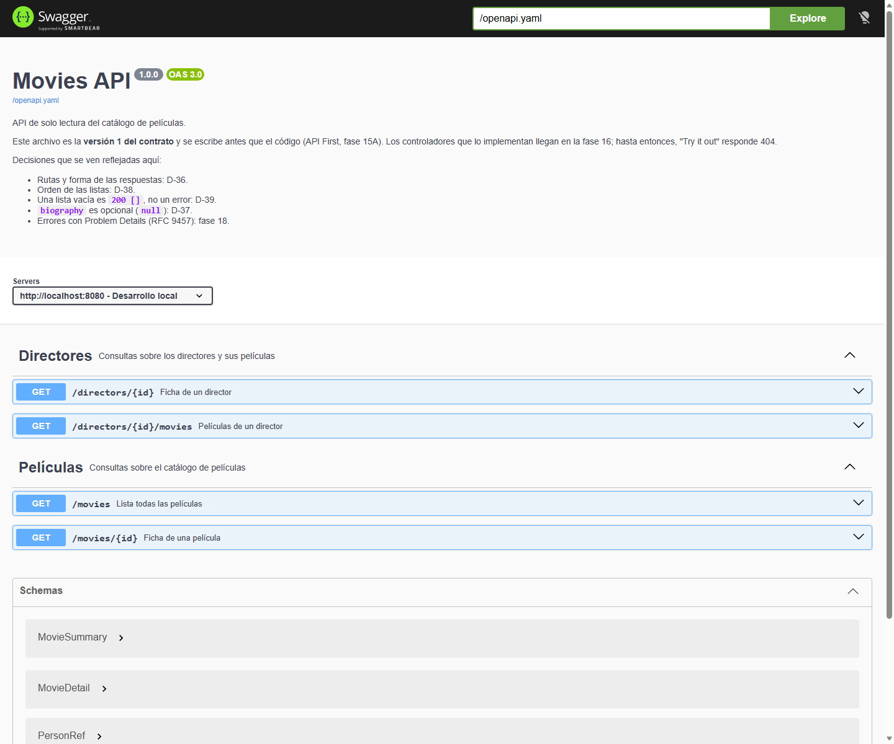

# Fase 15A — API First: el contrato antes del código

> Estado: **en curso**. 15A.1 y 15A.2 hechos el 2026-10-28; falta 15A.3, que necesita los controladores de la fase 16.
> Conceptos: [temario/15A-api-first.md](temario/15A-api-first.md). Decisión: [D-47](decisiones-tecnicas.md).

## En pocas palabras

> Este archivo es el **diario**. Para **entender** OpenAPI, Swagger UI y el enfoque *contract first*, lee primero el [tema 15A](temario/15A-api-first.md).

La API ya tiene **interfaz visible**: el contrato de la versión 1 está escrito en YAML, se sirve en `/openapi.yaml` y **Swagger UI** lo muestra en `http://localhost:8080/swagger-ui.html`.

Todavía **no hay controladores**: la UI documenta lo que la API *va a* ofrecer, no lo ejecuta. "Try it out" devuelve `404` hasta la fase 16. Eso es precisamente el enfoque **API First**: primero se acuerda el contrato, después se implementa.

## Por qué se adelanta

El plan colocaba la fase 15A entre la 15 y la 16. El alumno pidió ver la interfaz de los endpoints ahora, y el contrato **no depende de nada que falte**: las rutas y las formas de las respuestas se decidieron en la fase 8 (D-36 a D-39). Lo único que se adelanta es la dependencia web, que springdoc necesita para arrancar.

## Pasos

| Paso | Estado |
|---|---|
| 15A.1 El contrato de la v1 | ✅ Hecho: `src/main/resources/static/openapi.yaml` |
| 15A.2 OpenAPI y Swagger UI | ✅ Hecho: springdoc 3.2.0, UI en `/swagger-ui.html` |
| 15A.3 Contrato frente a implementación | ⏳ Pendiente: se comprueba en la fase 16 |

## 15A.1 El contrato

El archivo es la **fuente de verdad** de la versión 1 y vive en `src/main/resources/static/openapi.yaml`. Se elige `static/` por una razón práctica: Spring Boot sirve esa carpeta tal cual en la raíz, así que el contrato está en `/openapi.yaml` **sin escribir ni una línea de Java**, y viaja dentro del `.jar`.

Qué describe:

| Elemento | Decisión que refleja |
|---|---|
| `GET /movies`, `GET /movies/{id}`, `GET /directors/{id}`, `GET /directors/{id}/movies` | D-36 (rutas y forma de las respuestas) |
| `MovieSummary` frente a `MovieDetail` | D-36: la lista devuelve poco; la ficha, más |
| `PersonRef` = `{ id, fullName }` dentro de otra respuesta | D-36: el `id` viaja aunque hoy no se muestre, para no romper el contrato mañana |
| `DirectorDetail` con `firstName`/`lastName` y `biography` anulable | D-36 y D-37 |
| Descripciones del orden de cada lista | D-38 |
| "Lista vacía = `200 []`" | D-39 |
| `ProblemDetail` en `400` y `404` | RFC 9457; se programa en la fase 18 |

**No se inventa nada nuevo:** cada dato del contrato sale de una decisión ya tomada. Y no se añade el prefijo `/api/v1`: las rutas son las de D-36. La versión vive en `info.version` del documento; si algún día hace falta versionar por URL, será una decisión aparte.

Los ejemplos usan datos reales del `seed.sql` (The Prestige, Nolan, Bale, Caine, Jackman), así que sirven para comparar con las respuestas de la fase 16.

## 15A.2 Swagger UI

### Dependencias

| Dependencia | Versión | Por qué |
|---|---|---|
| `spring-boot-starter-webmvc` | 4.1.1 (gestionada por Boot) | Sin Spring MVC no hay servidor web ni Swagger UI. Estaba prevista para la 16; se adelanta |
| `springdoc-openapi-starter-webmvc-ui` | **3.2.0**, explícita | Swagger UI y el endpoint `/v3/api-docs`. Boot **no** gestiona esta versión |

La versión se comprobó en dos fuentes antes de escribirla: la web de springdoc (v3 es la rama para **Spring Boot 4**) y `maven-metadata.xml` de Maven Central (`<release>3.2.0</release>`).

### Configuración (`application.yaml`)

```yaml
springdoc:
  swagger-ui:
    url: /openapi.yaml      # la UI carga NUESTRO contrato, no el que genere el código
    operations-sorter: method
    tags-sorter: alpha
```

`springdoc.swagger-ui.url` es la pieza clave: sin ella, Swagger UI cargaría `/v3/api-docs`, que hoy está **vacío** porque no hay controladores.

### URLs

| URL | Qué devuelve |
|---|---|
| `/swagger-ui.html` | `302` hacia `/swagger-ui/index.html` |
| `/swagger-ui/index.html` | La interfaz (200, HTML) |
| `/openapi.yaml` | El contrato (200, YAML) |
| `/v3/api-docs` | Documento generado por springdoc; hoy `paths: {}` |
| `/v3/api-docs/swagger-config` | Configuración que lee la UI; incluye `"url":"/openapi.yaml"` |



### El test que lo protege

`OpenApiContractTests` arranca la aplicación en un puerto aleatorio y comprueba tres cosas:

1. `/openapi.yaml` responde `200` y contiene `openapi: 3.0.3`.
2. El YAML **parsea** y sus `paths` son exactamente los cuatro de la v1.
3. `/swagger-ui/index.html` responde `200` y es la página de Swagger UI.

Así, si alguien rompe el YAML o lo mueve de `static/`, el build falla.

## Comprobaciones reales (2026-10-28)

```
.\mvnw.cmd clean test
...
[INFO] Tests run: 2 ... DatabaseConnectionTests
[INFO] Tests run: 1 ... FlywayMigrationTests
[INFO] Tests run: 1 ... MoviesApplicationTests
[INFO] Tests run: 3 ... OpenApiContractTests
[INFO] Tests run: 7, Failures: 0, Errors: 0, Skipped: 0
[INFO] BUILD SUCCESS
```

Con la aplicación arrancada (`java -jar target\movies-0.0.1-SNAPSHOT.jar`):

```
--- /openapi.yaml ---
status=200 bytes=9024
--- /swagger-ui.html ---
status=302 redirect=http://localhost:8080/swagger-ui/index.html
--- /swagger-ui/index.html ---
status=200 type=text/html
--- /v3/api-docs/swagger-config ---
{"configUrl":"/v3/api-docs/swagger-config","operationsSorter":"method","tagsSorter":"alpha","url":"/openapi.yaml",...}
--- /v3/api-docs ---
{"openapi":"3.1.0","info":{"title":"OpenAPI definition","version":"v0"},"paths":{},"components":{}}
```

Detalles que conviene saber:

- Tomcat arranca en el **8080** (`Tomcat started on port 8080`). Antes la aplicación terminaba sola porque no había servidor web.
- El YAML se sirve como `application/octet-stream` (Spring no asocia `.yaml` a un tipo MIME). Swagger UI lo parsea igual; si algún día molesta, se corrige con un `ResourceHandler` propio.
- springdoc avisa en el log de que `/v3/api-docs` y `/swagger-ui.html` están activos "by default". Es un aviso pensado para producción; aquí son el objetivo.
- Aparece el aviso `spring.jpa.open-in-view is enabled by default`: es el paso **14.6** del plan, todavía pendiente.

## Lo que **no** hace todavía

- **No ejecuta los endpoints.** "Try it out" devuelve `404`: no hay controladores (fase 16).
- **No valida** las peticiones: no hay DTO ni Bean Validation (fases 16 y 18).
- **No genera** el documento desde el código. Eso llegará en la fase 16; el paso 15A.3 comparará lo generado con este contrato para que no se separen.

## Archivos tocados

| Archivo | Cambio |
|---|---|
| `pom.xml` | `spring-boot-starter-webmvc` y `springdoc-openapi-starter-webmvc-ui` 3.2.0 |
| `src/main/resources/application.yaml` | Bloque `springdoc` |
| `src/main/resources/static/openapi.yaml` | Contrato de la v1 (nuevo) |
| `src/test/java/com/daw/movies/OpenApiContractTests.java` | 3 tests del contrato y de la UI (nuevo) |

## Siguiente paso

**15A.3**, después de la fase 16: con los controladores escritos, activar el documento generado por springdoc (`/v3/api-docs`) y comprobar que coincide con `openapi.yaml`. Si no coincide, gana el contrato: se corrige el código, no el documento.
