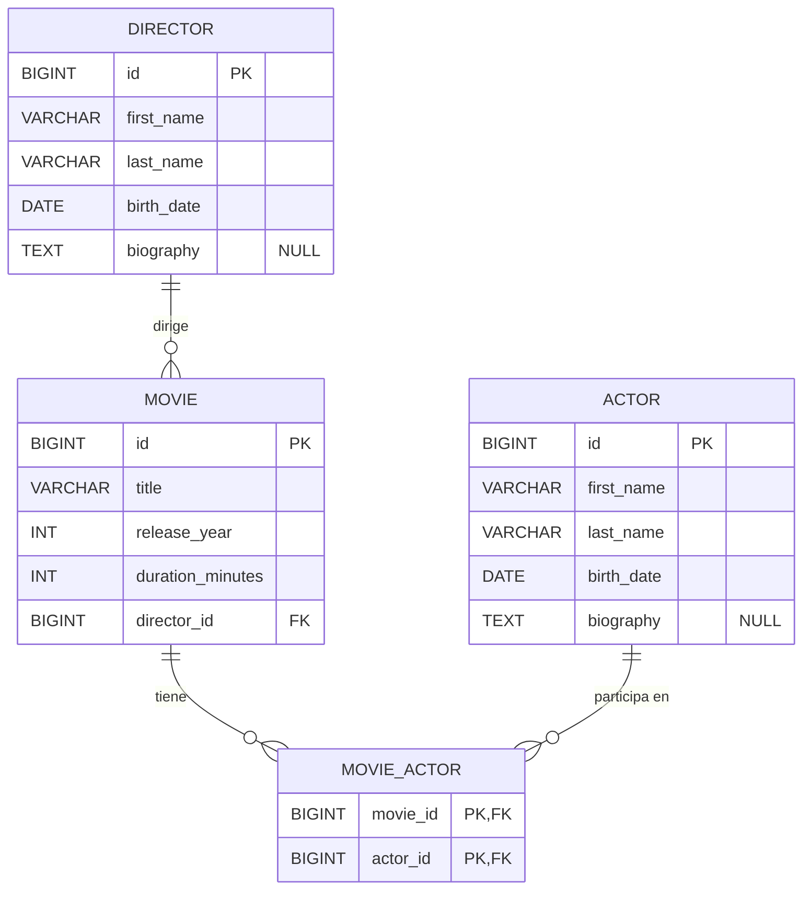

# 03 — Diseño del esquema relacional

> **Fase del plan:** 3 (Diseño del esquema relacional).
> El SQL de este tema es un **borrador de diseño**: todavía no se ejecuta. En la fase 8 lo convertiremos en migraciones de Flyway.

## Objetivo

Pasar del modelo conceptual (entidades, atributos y relaciones, [tema 02](02-entidades-atributos-y-relaciones.md)) a un **esquema relacional**: tablas, columnas con su tipo, claves primarias, claves foráneas y restricciones.

## 1. De entidad a tabla

En una base de datos relacional todo se guarda en **tablas**:

- Cada **tabla** representa un tipo de cosa (una entidad): `movie`, `director`, `actor`.
- Cada **fila** es una cosa concreta: la fila de *Inception*, la fila de Nolan.
- Cada **columna** es un atributo: `title`, `release_year`...

```
Tabla movie
| id | title        | release_year | duration_minutes | director_id |
|----|--------------|--------------|------------------|-------------|
|  3 | Inception    | 2010         | 148              | 1           |   ← una fila = una película
|  4 | Interstellar | 2014         | 169              | 1           |
         ↑ columna = atributo
```

### Reglas de nombres que seguimos

Por `base-standards.md`, los nombres van en **inglés**. Además:

| Regla | Ejemplo | Motivo |
|---|---|---|
| Tablas en **singular** | `movie`, no `movies` | Cada fila es *una* película; convención muy extendida. |
| `snake_case` (minúsculas y guiones bajos) | `release_year` | SQL no distingue bien mayúsculas en todos los sistemas; es la convención en SQL. |
| Clave primaria llamada `id` | `movie.id` | Sencillo y uniforme. |
| Clave foránea: `<tabla_referenciada>_id` | `director_id` | Se entiende sola a qué tabla apunta. |
| Restricciones con nombre | `fk_movie_director` | Los mensajes de error indicarán qué regla se ha incumplido. |

## 2. Tipos de datos

Cada columna necesita un **tipo** que diga qué valores admite.

| Columna | Tipo MariaDB | Por qué |
|---|---|---|
| `id` | `BIGINT` | Entero grande. Se corresponde con `Long` en Java. |
| `title` | `VARCHAR(255)` | Texto de longitud variable, hasta 255 caracteres. |
| `first_name`, `last_name` | `VARCHAR(100)` | Suficiente para nombres; `VARCHAR` solo ocupa lo que se usa. |
| `release_year` | `INT` | Ver la decisión de abajo. Se corresponde con `Integer` en Java. |
| `duration_minutes` | `INT` | Número entero de minutos. `Integer` en Java. |
| `birth_date` | `DATE` | Solo fecha, sin hora. Se corresponde con `LocalDate` en Java. |
| `biography` | `TEXT` | Texto largo (varios párrafos), sin un límite pequeño como el de `VARCHAR(n)`. `String` en Java. *Añadida en la fase 8, D-37.* |

**¿Por qué `INT` y no `YEAR` o `SMALLINT` para el año?**
- `YEAR` es un tipo propio de MariaDB/MySQL con un rango limitado (1901–2155) y no tiene un equivalente directo y cómodo en Java.
- `SMALLINT` ocuparía menos espacio, pero en Java se corresponde con `Short`, un tipo poco habitual que complicaría el código sin ninguna ventaja apreciable con 10 películas.
- `INT` encaja directamente con `Integer`. **Elegimos la opción más sencilla de mantener.**

## 3. Claves primarias (PK)

La **clave primaria** es la columna (o columnas) que **identifica de forma única** cada fila. La base de datos garantiza que:

- **no se repite** (dos filas no pueden tener el mismo `id`);
- **nunca está vacía** (no puede ser `NULL`).

### Clave natural vs. clave sustituta

| Tipo | Qué es | Ejemplo | Problema |
|---|---|---|---|
| **Natural** | Un dato real que ya identifica la cosa | El título de la película | Puede repetirse (remakes) o corregirse |
| **Sustituta** (*surrogate*) | Un número sin significado, creado solo para identificar | `id = 3` | Ninguno de los anteriores; no dice nada por sí mismo |

Usamos **claves sustitutas** en `movie`, `director` y `actor`, generadas automáticamente con **`AUTO_INCREMENT`**: la base de datos asigna 1, 2, 3... al insertar cada fila, sin que tengamos que elegir el número.

## 4. Relación uno a muchos (1:N): la clave foránea

"Un director dirige muchas películas; una película tiene un director."

**¿Dónde guardamos la conexión?** Hay dos sitios posibles:

❌ **En `director`, una columna con las películas:**
```
| id | last_name | movies       |
|  1 | Nolan     | 1, 2, 3, 4   |   ← una celda con varios valores
```
Una celda no debe contener listas: no se puede buscar, ordenar ni proteger bien. Esto rompe la **primera forma normal** (cada celda, un solo valor).

✅ **En `movie`, una columna que apunta al director:**
```
Tabla director              Tabla movie
| id | last_name |          | id | title        | director_id |
|  1 | Nolan     |  ◄────── |  3 | Inception    | 1           |
|  2 | Tarantino |  ◄──┐    |  4 | Interstellar | 1           |
                       └─── |  5 | Pulp Fiction | 2           |
```
Cada película tiene **un único** director → cabe en **una** celda.

**Regla práctica:** en una relación 1:N, la clave foránea va **siempre en el lado "muchos"** (aquí, `movie`).

### Qué es una clave foránea (FK)

Una **clave foránea** es una columna cuyo valor **debe existir** como clave primaria en otra tabla. La base de datos lo comprueba siempre. A esto se le llama **integridad referencial**:

- Si intentamos insertar una película con `director_id = 99` y no existe el director 99 → **error**.
- Si intentamos borrar a Nolan mientras tiene películas → **error** (con la opción que elegimos, ver sección 6).

Así, la base de datos nunca contendrá una película que apunte a un director inexistente.

Como la película **debe** tener director (fase 2), la columna es `director_id BIGINT NOT NULL`.

## 5. Relación muchos a muchos (N:M): la tabla intermedia

"Una película tiene muchos actores; un actor participa en muchas películas."

**¿Podemos poner una clave foránea en uno de los dos lados?**

❌ `actor_id` en `movie` → solo cabría **un** actor por película.
❌ `movie_id` en `actor` → cada actor solo podría estar en **una** película.

Ninguno de los dos lados es el "muchos" en exclusiva: **los dos lo son**. La solución es crear una **tabla intermedia** (también llamada tabla de unión) cuya única función es guardar **parejas** película–actor:

```
Tabla movie                Tabla movie_actor           Tabla actor
| id | title        |      | movie_id | actor_id |      | id | last_name   |
|  3 | Inception    | ◄─── |    3     |    1     | ───► |  1 | DiCaprio    |
|    |              | ◄─── |    3     |    2     | ───► |  2 | Caine       |
|  4 | Interstellar | ◄─── |    4     |    2     | ───► |    |             |
|    |              | ◄─── |    4     |    5     | ───► |  5 | McConaughey |
```

- **Cada fila de `movie_actor` es una participación**: "el actor 1 sale en la película 3".
- `movie_actor.movie_id` es una FK hacia `movie.id`.
- `movie_actor.actor_id` es una FK hacia `actor.id`.

Fíjate en que **una N:M se convierte en dos 1:N**: una película tiene muchas filas en `movie_actor` y un actor tiene muchas filas en `movie_actor`.

### La clave primaria de la tabla intermedia: compuesta

¿Puede DiCaprio aparecer **dos veces** en *Inception*? No tendría sentido. Por eso la clave primaria de `movie_actor` es la **pareja** `(movie_id, actor_id)`: una **clave primaria compuesta**. La base de datos impide repetir la misma pareja.

| Alternativa | Valoración |
|---|---|
| **PK compuesta `(movie_id, actor_id)`** ✅ | Impide duplicados por sí misma; la tabla no tiene datos propios. |
| Columna `id` propia + `UNIQUE (movie_id, actor_id)` | Necesaria si la participación fuera una entidad con datos propios (p. ej., el personaje). Hoy añadiría una columna sin utilidad. |

## 6. Restricciones: reglas que garantiza la base de datos

Una **restricción** (*constraint*) es una regla que la base de datos **comprueba siempre**, venga el dato de donde venga (nuestra aplicación, un script, una persona escribiendo SQL a mano).

| Restricción | Qué garantiza | Uso en nuestro esquema |
|---|---|---|
| `PRIMARY KEY` | Identificador único y no vacío | `id` en las tres tablas principales; `(movie_id, actor_id)` en `movie_actor` |
| `NOT NULL` | La columna no puede quedar vacía | Todas las columnas (los datos son obligatorios, ver decisión D-10), **menos `biography`**: se puede dar de alta un director o un actor sin tener aún su biografía (D-37, fase 8) |
| `FOREIGN KEY` | El valor existe en la tabla referenciada | `director_id`, `movie_id`, `actor_id` |
| `CHECK` | El valor cumple una condición | Duración mayor que 0; año de estreno razonable |

### `CHECK`: valores con sentido

```sql
CONSTRAINT chk_movie_duration_positive CHECK (duration_minutes > 0)
CONSTRAINT chk_movie_release_year CHECK (release_year >= 1888)
```

- Una película de 0 o −5 minutos no tiene sentido.
- 1888 es el año de *Roundhay Garden Scene*, considerada una de las primeras películas conservadas: ningún estreno puede ser anterior.

¿Y un límite superior para el año? No lo ponemos: el límite cambiaría cada año, y una base de datos no debe depender de "la fecha de hoy" en una restricción. Si hace falta, esa validación se hará en la aplicación (fase 18).

### `ON DELETE`: qué pasa al borrar una fila referenciada

Cuando una fila es apuntada por una FK, al intentar borrarla hay que decidir qué hacer:

| Opción | Efecto |
|---|---|
| `RESTRICT` | Prohíbe el borrado mientras haya filas que la referencien. |
| `CASCADE` | Borra también, automáticamente, las filas que la referencian. |
| `SET NULL` | Deja la FK de esas filas a `NULL` (solo si la columna lo permite). |

Nuestras elecciones:

| Clave foránea | `ON DELETE` | Motivo |
|---|---|---|
| `movie.director_id → director.id` | `RESTRICT` | Borrar a Nolan no debe borrar sus 4 películas a escondidas. Primero hay que decidir qué hacer con ellas. `SET NULL` no es posible porque `director_id` es obligatorio. |
| `movie_actor.movie_id → movie.id` | `CASCADE` | Si se borra una película, sus participaciones ya no significan nada: deben desaparecer con ella. |
| `movie_actor.actor_id → actor.id` | `RESTRICT` | Borrar a DiCaprio no debe sacarlo en silencio de 4 películas. Se exige quitarlo antes de forma explícita. |

**Regla de prudencia:** `CASCADE` solo cuando los datos dependientes **no tienen sentido sin el principal** (las participaciones sin la película). En el resto, `RESTRICT`, que es lo más seguro.

## 7. Índices (lo justo)

Un **índice** es como el índice alfabético de un libro: permite encontrar filas sin recorrer toda la tabla.

- Toda **clave primaria** tiene índice automáticamente.
- En MariaDB (motor InnoDB), toda **clave foránea** necesita un índice; si no existe, MariaDB lo crea automáticamente.
- La PK `(movie_id, actor_id)` ya sirve para buscar "actores de una película". Para buscar "películas de un actor", la FK `actor_id` tendrá su propio índice.

Con estas reglas, **no necesitamos crear índices a mano** por ahora.

## 8. Orden de creación de las tablas

Una tabla con clave foránea **solo puede crearse si la tabla a la que apunta ya existe**:

```
1. director      (no depende de nadie)
2. actor         (no depende de nadie)
3. movie         (depende de director)
4. movie_actor   (depende de movie y de actor)
```

El mismo orden se aplica al **insertar datos** (fase 9): primero los directores, luego las películas que los usan, etc. Al **borrar** se sigue el orden inverso.

## 9. Diagrama entidad-relación



Cómo leer los símbolos: `||` = exactamente uno; `o{` = cero o muchos. Por ejemplo, `DIRECTOR ||--o{ MOVIE` se lee "cada película tiene exactamente un director; cada director tiene cero o muchas películas".

Versión en texto (por si el visor no muestra Mermaid):

```
director (id PK, first_name, last_name, birth_date, biography NULL)
    1
    │
    N
movie (id PK, title, release_year, duration_minutes, director_id FK → director.id)
    1
    │
    N
movie_actor (movie_id PK/FK → movie.id, actor_id PK/FK → actor.id)
    N
    │
    1
actor (id PK, first_name, last_name, birth_date, biography NULL)
```

## 10. Borrador del SQL (no se ejecuta todavía)

```sql
CREATE TABLE director (
    id         BIGINT       NOT NULL AUTO_INCREMENT,
    first_name VARCHAR(100) NOT NULL,
    last_name  VARCHAR(100) NOT NULL,
    birth_date DATE         NOT NULL,
    biography  TEXT         NULL,   -- opcional (D-37, fase 8)
    CONSTRAINT pk_director PRIMARY KEY (id)
);

CREATE TABLE actor (
    id         BIGINT       NOT NULL AUTO_INCREMENT,
    first_name VARCHAR(100) NOT NULL,
    last_name  VARCHAR(100) NOT NULL,
    birth_date DATE         NOT NULL,
    biography  TEXT         NULL,   -- opcional (D-37, fase 8)
    CONSTRAINT pk_actor PRIMARY KEY (id)
);

CREATE TABLE movie (
    id               BIGINT       NOT NULL AUTO_INCREMENT,
    title            VARCHAR(255) NOT NULL,
    release_year     INT          NOT NULL,
    duration_minutes INT          NOT NULL,
    director_id      BIGINT       NOT NULL,
    CONSTRAINT pk_movie PRIMARY KEY (id),
    CONSTRAINT fk_movie_director FOREIGN KEY (director_id)
        REFERENCES director (id) ON DELETE RESTRICT,
    CONSTRAINT chk_movie_duration_positive CHECK (duration_minutes > 0),
    CONSTRAINT chk_movie_release_year CHECK (release_year >= 1888)
);

CREATE TABLE movie_actor (
    movie_id BIGINT NOT NULL,
    actor_id BIGINT NOT NULL,
    CONSTRAINT pk_movie_actor PRIMARY KEY (movie_id, actor_id),
    CONSTRAINT fk_movie_actor_movie FOREIGN KEY (movie_id)
        REFERENCES movie (id) ON DELETE CASCADE,
    CONSTRAINT fk_movie_actor_actor FOREIGN KEY (actor_id)
        REFERENCES actor (id) ON DELETE RESTRICT
);
```

Pendiente para fases posteriores:
- **Juego de caracteres** (tildes de *Amenábar*, *Verdú*): se configurará y comprobará en la fase 4, al crear la base de datos (`utf8mb4`).
- **Motor de almacenamiento**: MariaDB usa InnoDB por defecto, que es el que admite claves foráneas. Lo comprobaremos en la fase 8.
- En la fase 8 este borrador se repartirá en **migraciones versionadas**.

## 11. Duplicación aceptada: `director` y `actor`

Las dos tablas tienen las mismas columnas (`base-standards.md` pide señalar la duplicación).

| Opción | Ventaja | Inconveniente |
|---|---|---|
| **Tablas separadas** ✅ | Muy fácil de entender y consultar; cada relación es directa. | Columnas repetidas; quien dirige y actúa (Tarantino) estaría dos veces. |
| Tabla `person` + papeles | Sin duplicación; una persona, varios papeles. | Más tablas y consultas más complejas; no lo necesitamos con nuestros datos. |

**Decisión:** tablas separadas. La duplicación es de **estructura** (cuatro columnas), no de **datos**: en nuestro conjunto nadie es director y actor a la vez. Si el proyecto creciera y fuese habitual, sería el momento de revisarlo.

## 12. Qué errores lanza MariaDB cuando se incumple una clave foránea

Las restricciones no "avisan": **rechazan la operación con un error** y la fila no se guarda (o no se borra). Estos son los mensajes que veremos (los provocaremos a propósito en la fase 9):

**Insertar una película con `director_id = 99` cuando no existe el director 99:**

```
ERROR 1452 (23000): Cannot add or update a child row: a foreign key constraint fails
(`movies`.`movie`, CONSTRAINT `fk_movie_director` FOREIGN KEY (`director_id`) REFERENCES `director` (`id`))
```

Cómo leerlo:
- **`1452`**: código del error en MariaDB. **`23000`**: código estándar SQL (*SQLSTATE*) de "violación de una restricción de integridad".
- **"child row"** (fila hija): la fila que *apunta* a otra (la película). La **fila padre** es la apuntada (el director).
- Indica la tabla (`movies`.`movie`) y **el nombre de la restricción** (`fk_movie_director`). Por eso damos nombre a las restricciones: el error dice exactamente qué regla falló.

Atención a un matiz: el problema **no** es el `id` de la película (ese puede ser cualquiera que no esté usado), sino el valor de la **clave foránea** `director_id`, que apunta a un director inexistente.

**Borrar a Nolan mientras tiene películas (`ON DELETE RESTRICT`):**

```
ERROR 1451 (23000): Cannot delete or update a parent row: a foreign key constraint fails
(`movies`.`movie`, CONSTRAINT `fk_movie_director` FOREIGN KEY (`director_id`) REFERENCES `director` (`id`))
```

Aquí la fila afectada es la **padre** (el director) y el error indica qué tabla hija la está usando.

**Crear `movie_actor` antes que `movie`:** la sentencia `CREATE TABLE movie_actor` falla porque su FK hace referencia a una tabla que todavía no existe (en MariaDB, error 1005 con *errno 150*, "Foreign key constraint is incorrectly formed"). Ojo con el matiz: **no es la tabla `actor` la que depende de `movie`**; `actor` no depende de nadie. Es la tabla **`movie_actor`** la que depende de `movie` y de `actor`, porque contiene claves foráneas que apuntan a las dos.

## Resumen

- **Tabla** = entidad; **fila** = una cosa concreta; **columna** = atributo.
- **Clave primaria**: identifica cada fila; usamos claves sustitutas con `AUTO_INCREMENT`.
- **Clave foránea**: apunta a la PK de otra tabla; la base de datos garantiza que exista (**integridad referencial**).
- **1:N** → la FK va en el lado "muchos" (`movie.director_id`).
- **N:M** → **tabla intermedia** (`movie_actor`) con **PK compuesta**; equivale a dos relaciones 1:N.
- **Restricciones** (`NOT NULL`, `CHECK`, `FOREIGN KEY`, `ON DELETE`) protegen los datos venga de donde venga el cambio.
- Las tablas se crean (y los datos se insertan) **en orden de dependencias**.

## Preguntas de repaso

**¿Por qué la clave foránea del director va en `movie` y no en `director`?**
Porque en una relación 1:N va en el lado "muchos": cada película tiene un único director (cabe en una celda), mientras que un director tiene varias películas (no cabrían en una celda sin romper la primera forma normal).

**¿Por qué una relación N:M necesita una tabla intermedia?**
Porque los dos lados son "muchos": una columna en cualquiera de las dos tablas solo permitiría un valor. La tabla intermedia guarda cada pareja película–actor como una fila.

**¿Qué impide que DiCaprio aparezca dos veces en *Inception*?**
La clave primaria compuesta `(movie_id, actor_id)` de `movie_actor`.

**¿Qué ocurre si intentamos borrar a Nolan?**
Error: la FK `fk_movie_director` tiene `ON DELETE RESTRICT` y existen películas que lo referencian.

**¿Qué ocurre si borramos la película *Inception*?**
Se borra, y con ella sus filas de `movie_actor` (`ON DELETE CASCADE`). Los actores DiCaprio y Caine siguen existiendo.

**¿En qué orden se crean las tablas y por qué?**
`director` y `actor`, después `movie` y por último `movie_actor`, porque una tabla con FK necesita que exista la tabla a la que apunta.
